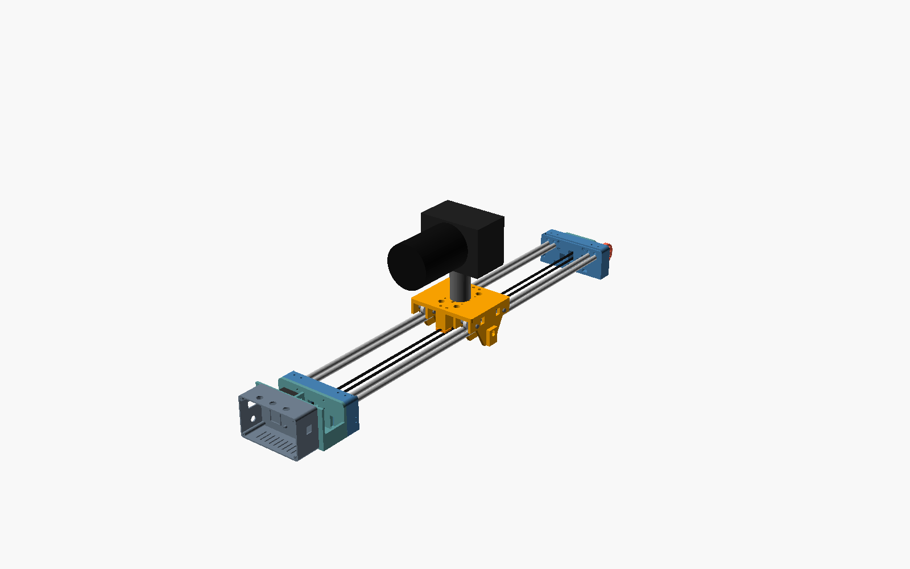
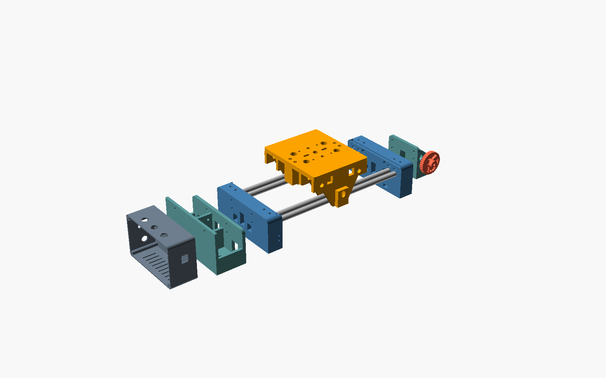
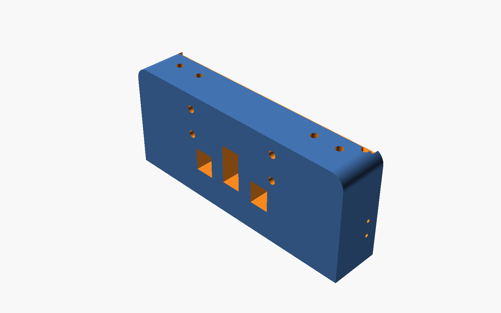
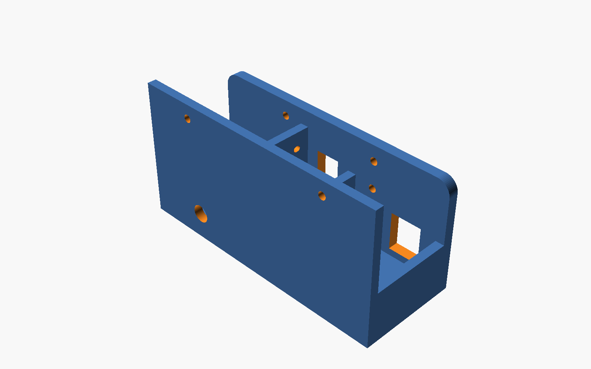
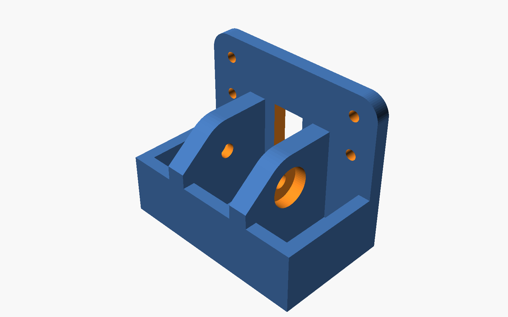
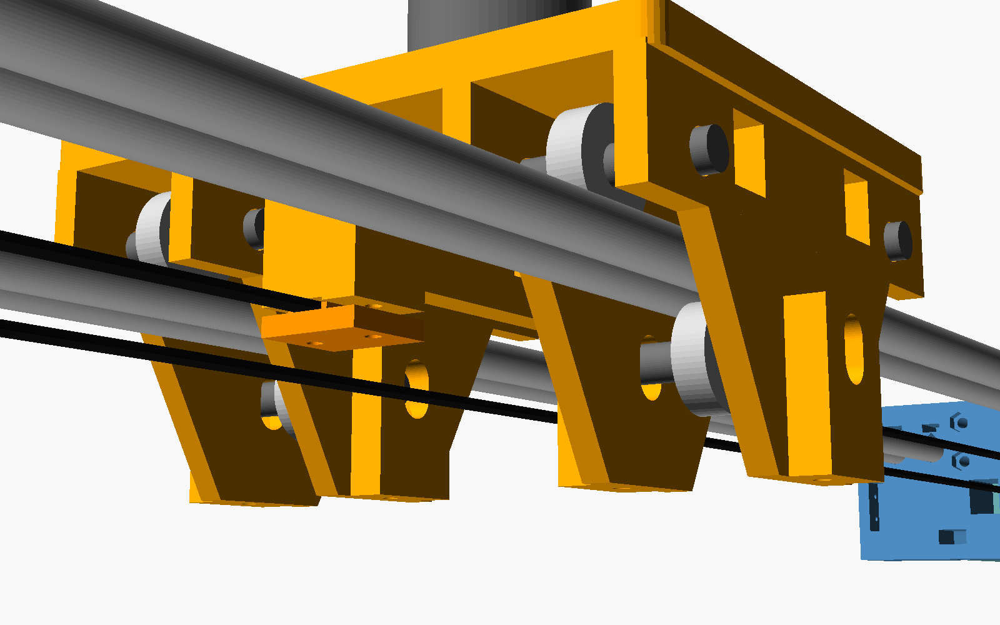

# Assembly

Tools: 2.5 / 3 / 4 / 6 mm Allen keys, 13 mm spanner (M8), pliers, soldering iron, multimeter, 8.5 mm drill
(by hand, only if the M8 bolts are tight), a drop of light oil.

The slider is built from **modules** that bolt together (see [DIMENSIONS.md](DIMENSIONS.md)):

## 1. End blocks (×2, identical)

1. **Tripod nuts:** push two **1/4"-20** nuts (outer) and one **3/8"-16** nut (centre) into the slots on the
   **inner face**. A drop of CA glue holds them. Pull each into its hex pocket with a tripod screw from below.
2. **Rod set-screws:** slide an **M4 nut** into each of the 4 slots above the rod sockets (inner face), and start
   an **M4×16** from the top. Don't tighten yet.
3. **Pod nuts:** press 4 **M4 nuts** into the hex pockets on the inner face (the 4 holes at X ±30).
4. **Micro switch:** push the switch into the pocket below the rods (lever facing the carriage), fix it with
   2× M2 from the outside. Thread its 2 wires (COM + NO) up the small hole into the top channel.

## 2. Motor pod

1. Put the **GT2 pulley** on the NEMA17 shaft (grub screw on the flat). Don't tighten yet.
2. Lower the motor into the pod, on the side of the plate away from the belt slot, centring boss in the big
   hole. Fix it with **4× M3×10** from the pulley side. The holes are slotted 1 mm for belt tension.
3. Line the pulley teeth up with the middle of the belt slot. Tighten the grub screw.
4. Bolt the pod to an end block: **4× M4×35** from the pod side into the nuts in the end block.

## 3. Crank pod

1. Press a **625ZZ** into the outside of each wall.
2. Push the **5 mm shaft (85 mm)** in through one bearing, through the **GT2 pulley** (an M5 washer each side),
   and out through the other bearing. Centre the pulley and tighten its grub screw.
3. **Hand wheel** on the long end (outside the pod), M3 grub screw. **M5×30 + spinner** in the wheel's outer hole.
4. Bolt the pod to the other end block with **4× M4×35**.

*Manual-only slider?* Skip the motor pod, the belt and the electronics. Fit the crank pod (or no pod) and
push the carriage by hand.

## 4. Carriage (6 rollers)

Each track (a pair of rods) gets **2 rollers on top** in the groove between the two rods, and **1 roller
underneath** that 2 springs push up into the same groove. Every contact rolls; nothing slides.

1. **Belt-clamp nuts:** drop **M3 nuts** into the 4 hex pockets on top of the belt-clamp blocks.
2. **Module nuts:** press **4 M4 nuts** into the hex pockets under the top plate (40 × 40 square).
3. **Top rollers (×4):** **M8×50** → washer → cheek → **spacer** → 608 → **spacer** → cheek → washer → **nyloc**.
   Tighten until the bearing can't wobble but still spins freely. The spacer's small lip touches only the
   bearing's **inner** ring.
4. **Springs:** in each of the 4 pockets under the bottom-roller slots: **spring seat** (spigot up) →
   **bed-levelling spring**. Screw an **M4×12** into the hole underneath, just far enough to hold the seat.

## 5. Rails

1. Roll each 10 mm rod on a flat table. A bent rod wobbles; don't use it.
2. Push the 4 rods into **one** end-block assembly until they bottom out. Tighten its 4 set-screws.
3. Set the carriage on the rods: the top rollers sit in the two grooves.
4. Push the other end-block assembly onto the rods. Leave its set-screws **loose**.
5. **Bottom rollers (×2):** from below, hold a 608 with a spacer each side between the cheeks, under the rod
   pair, and slide an **M8×60** through the slots, pushing the springs down. Washer + **nyloc**, snug only:
   the axle must stay free to move up and down in the slot.
6. Slide the carriage to the loose end and back a few times, so it lines the rods up. Tighten the
   set-screws.

### Preload

The springs keep the bottom roller pressed up with the same force everywhere on the rail, even where a
rod is slightly thinner or bent. That's why it doesn't bind like a fixed adjustment.

* Turn each **M4 adjuster** in until the carriage has **no play** when you try to lift or twist it, then
  stop. That's usually 1–3 turns after the spring starts compressing.
* More preload = stiffer (good for steep angles); less = lighter rolling. With the camera level, very
  little is needed because gravity holds the top rollers down.

## 6. Belt

1. Clamp one belt end under the **motor-side** clamp block: belt **teeth down**, the **clamp plate** (teeth
   up) under it, **2× M3×16** from below.
2. Run the belt through the motor pod, around the motor pulley, along the bottom, around the crank-pod
   pulley and back to the carriage.
3. Pull it tight (a low "twang", not rock-hard) and clamp it with the second plate. Use the **thumb knob** on
   one of these two screws: that's the quick-release for free gliding.
4. Fine tension: loosen the 4 motor screws, slide the motor in its slots, retighten.

## 7. Electronics box

Wire it per [WIRING.md](WIRING.md) (perfboard, GX12 sockets, jack, switch, lid controls). Then:

1. Fix the box to the motor pod's rear wall: **2× M4×12** through the box floor, nuts inside the pod.
2. Plug in **MOTOR**, **ENDSTOPS** (the cable splits to both end blocks along their top channels) and
   optionally **SHUTTER**.
3. Before the first power-up: **LM2596 → 5.0 V** (ESP32 unplugged) and **TMC2209 Vref ≈ 1.0 V**.

## 8. Firmware and first test

Flash per [../firmware/README.md](../firmware/README.md), then with the **camera off the slider**:

1. Join Wi-Fi **CamSlider-XXXX** (password `slider123`) → **http://192.168.4.1**.
2. **Home**. The carriage should move toward the end with the **MIN** switch. Wrong way → STOP, *Settings
   → Invert dir = 1 → Save*.
3. Jog to the far end and set *Travel* to that reading minus a few mm.
4. Mount the ball head, then the camera.

---

## Lowest friction: checklist

Rolling friction of a good 608 on hardened rod is about 0.1–0.2 % of the load. With 1.8 kg on it, that's a
push of a few grams. In practice these decide how free it feels:

| # | Do this | Why |
|---|---------|-----|
| 1 | Use **hybrid ceramic** 608s or a **good brand** (SKF/NSK/NTN/FAG). Avoid no-name "2RS" | rubber seals (2RS) drag much more than metal shields (ZZ) |
| 2 | Wash new bearings in **IPA**, dry them, add **one drop of light oil** (sewing-machine/bearing oil) | factory grease is thick and adds drag. Oil runs free |
| 3 | Wipe the rods with IPA, then a cloth with a trace of oil. Keep them clean | dust and grit are the main source of noise and "notchy" feel |
| 4 | Rods **straight and parallel** (step 5.6 above) | a bent rod or misaligned block makes tight spots |
| 5 | **Minimum preload** that removes play | every extra newton of preload adds friction |
| 6 | Top rollers: nyloc **snug, not crushing** the bearing | over-tight axles side-load the bearing |
| 7 | **Free glide:** loosen the thumb knob and slip the belt out | the belt + motor detent add ~3–4 N. That is far more than the rollers |
| 8 | **Hand mode with belt on:** `MOTOR OFF`, then push or crank | the driver no longer holds the motor, so only the detent torque is left |

## Mounting options

| Use | How |
|-----|-----|
| **2 tripods** | one under each end block (1/4" or 3/8"). Level both. Best for long or heavy moves |
| **1 tripod** | under the **motor end** (heavier), short rails only, camera near that end |
| **Table / floor** | on the flat end-block bottoms, or add the **table feet** (screw into a 1/4" nut) with rubber pads |
| **Angled** | different tripod heights. Keep the slope under ~30°, add a little preload and motor current |

## Driving modes

| Mode | How | Use |
|------|-----|-----|
| **Motor** | app / buttons / knob | repeatable, eased, timed moves, time-lapse |
| **Electronic hand wheel** | turn the box knob: 5 mm per click, press for 0.5 mm | precise framing, motor holds position |
| **Crank** | `MOTOR OFF` (app, or hold the knob), turn the wheel: 40 mm per turn | slow manual moves with the belt on |
| **Push** | `MOTOR OFF` and push the carriage | quick manual moves |
| **Free glide** | loosen the thumb knob, slip the belt out | lightest feel, like a plain manual slider. **HOME** after re-clamping |
