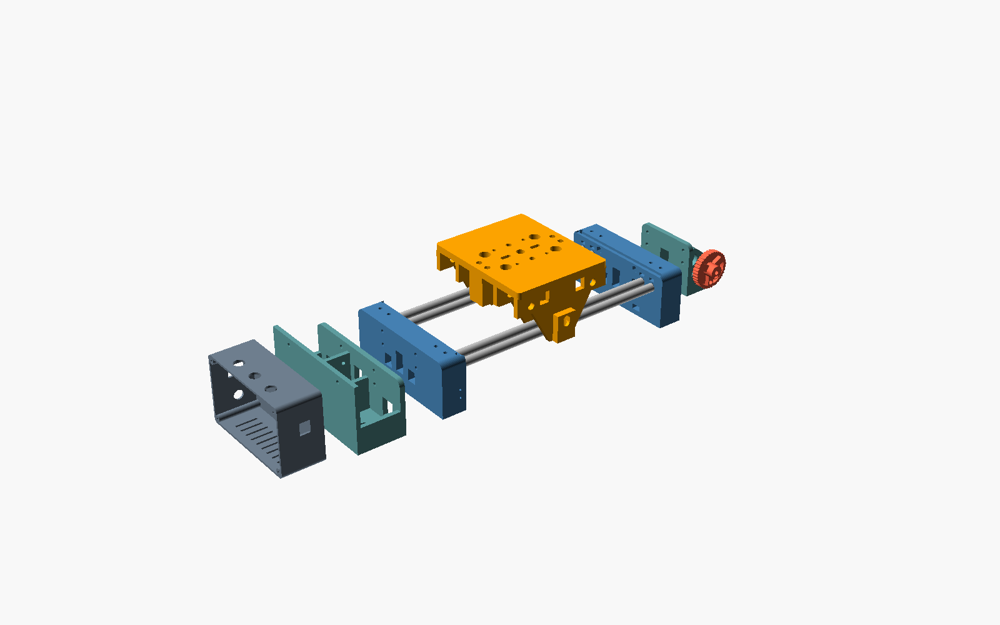

# Dimensions & Interfaces

All values come from `cad/config.scad`. Change them there and run `cad/export_stl.sh` + `cad/check_fit.sh`.
Units: mm. X = across the rail, Y = along the rail, Z = up from the table.



## Modules

```
 [ electronics box ]─┐
                     │ 2x M4
 [ MOTOR POD ]═══════╡ 4x M4x35          4x 10 mm rods            4x M4x35 ╞═══[ CRANK POD ]──( hand wheel )
                     [ END BLOCK ]════════════════════════════════[ END BLOCK ]
                                   ═══[ CARRIAGE  6x 608 ]═══
                                         │ 4x M4 / 40x40
                                    [ top modules: ball head, clamp ... ]
```

| Module | Printed part(s) | Connects with | Swap / options |
|--------|-----------------|---------------|----------------|
| **End block** | `end_block.stl` ×2 (identical) | rods (blind sockets + M4 set-screws), pod (4× M4×35), tripods (1/4" + 3/8" nuts) | either end takes either pod, or no pod at all |
| **Motor pod** | `motor_pod.stl` | end block (4× M4×35), electronics box (2× M4×12) | put it on the left or right end |
| **Crank pod** | `crank_pod.stl` + `hand_wheel.stl` + `crank_spinner.stl` | end block (4× M4×35) | without a motor pod, the slider is manual-only (no belt needed) |
| **Carriage** | `carriage.stl` + 12 `roller_spacer` + 4 `spring_seat` + 2 `belt_clamp_plate` | 6× 608 on M8 axles | top interface for future modules |
| **Electronics box** | `elec_box.stl` + `elec_lid.stl` | motor pod (2× M4), cables via 3× GX12 plugs | unplug it and use the box on another slider |
| **Table feet** | `table_foot.stl` ×2 | end-block 1/4" nut | optional |

### Pod interface (end block outer face)

* 4 holes Ø4.4 at **X = ±30, Z = 40 and Z = 56**, through the 30 mm block
* M4 nuts sit in hex pockets **5 mm deep** in the inner face, so an **M4×35** doesn't stick out
* belt window: X ±7, Z 19…45

### Carriage top interface

* **3/8"** centre hole (Ø9.8) + **2× 1/4"** at X = ±20 (Ø6.6) → ball head / fluid head screw from below
* **4× M4 on a 40 × 40 mm square** (X, Y = ±20) with nuts trapped underneath → for future modules
* 2 anti-twist slots (5 mm wide) at Y = ±16…24 for heads with locating pins
* top surface Z = **80.4** (from the table)

### Tripod / table

* every end block: **3/8"-16** at the centre + **2× 1/4"-20** at X = ±35, all at Y = 15 mm from the block's outer face
* two tripods: one under each end block. One tripod: under the **motor end** with a short rail.

## Key heights (from the table, no feet)

| What | Z |
|------|---|
| rod centres | 45.0 |
| top roller axles | 58.9 |
| bottom roller axles (nominal) | 31.1 |
| carriage top plate | 72.4 – 80.4 |
| belt top run | 37.4 |
| lowest point of the carriage | 7.1 |
| end block top | 65 |
| motor pod rear wall top | 78 |
| electronics box (mounted) | 0 – 80 |

## Rails

| | |
|---|---|
| rods | 4 × Ø10, X = **−58, −42, +42, +58** |
| tracks | 2 tracks, **100 mm** apart; rods of a track **16 mm** apart (6 mm gap) |
| roller contact | 608 (Ø22) sits on both rods of a track; centre 13.86 mm above/below the rod centres, contact angle ≈ 30° from vertical |
| rod in block | 26 mm (blind socket, rod stops 4 mm from the outer face) |

**Travel** = rod length − 52 (in the blocks) − 120 (carriage) − ~20 (switch levers).

| rod length | travel | belt | 5 mm shaft |
|------------|--------|------|------------|
| 800 | ≈ 600 | 2.0 m | 85 mm |
| 1000 | ≈ 800 | 2.5 m | 85 mm |

## Overall size (800 mm rods, with motor pod, crank pod and box)

* length ≈ **1000 mm** (box 50 + motor pod 58 + rail 808 + crank pod 48 + wheel)
* width ≈ **156 mm** (carriage); end blocks 150 mm
* height ≈ **81 mm** to the carriage top (before the ball head)

## Printed part sizes (Ender-3 V3: 220 × 220 × 250)

`cad/check_fit.sh` prints this and checks for collisions between assembled parts:

| Part | Size X × Y × Z | Qty |
|------|----------------|-----|
| end_block | 150 × 30 × 65 | 2 |
| motor_pod | 150 × 58 × 78 | 1 |
| crank_pod | 80 × 48 × 65 | 1 |
| carriage | 156 × 120 × 73 | 1 |
| elec_box | 130 × 80 × 50 | 1 |
| elec_lid | 130 × 80 × 4.4 | 1 |
| hand_wheel | 46 × 46 × 16 | 1 |
| roller_spacer | 13 × 13 × 10.5 | 12 |
| spring_seat | 8.2 × 8.2 × 4 | 4 |
| belt_clamp_plate | 22 × 20 × 5.2 | 2 |
| table_foot | 70 × 34 × 8 | 2 |
| thumb_knob, crank_spinner, encoder_knob | small | 1 each |

Collision checks (all **CLEAR**): carriage vs rods, belt, end block at the end of travel. Also rollers
vs rods, carriage and belt; motor, pulleys and belt vs pods/blocks; electronics box vs motor pod; hand
wheel vs crank pod.

## Bought-part dimensions the design depends on

| Part | Dimension used | If yours differs |
|------|----------------|------------------|
| 10 mm rod | hole 10.25 | `rod_hole` |
| 608 bearing | 22 × 8 × 7 | `roller_od`, `roller_w` |
| bed spring | ≤ 8.5 OD, ~20 long | `spring_d` (pocket 9) |
| NEMA17 | 42.3 square, 31 mm hole pattern, 22 mm boss | `nema_*` |
| GT2 20T pulley | pitch Ø12.73, 5 mm bore | `pulley_pd` |
| 625ZZ | 16 × 5 × 5 | `b625_od`, `b625_w` |
| micro switch | 20 × 10 × 6.4 body, M2 holes 9.5 apart | pocket in `end_block()` |
| 1/4" nut / 3/8" nut | 7/16" / 9/16" across flats | `q14_nut`, `q38_nut` |
| ESP32 DevKit 30-pin | 51.5 × 28.3 | perfboard layout |
| LM2596 module | 43 × 21 | frame in `elec_box()` |
| GX12 socket | 12 mm hole | `gx12_xs` |
| DC jack (panel) | 11 mm hole | `elec_box()` |
| KCD1 switch | 19.2 × 13.2 cut-out | `elec_box()` |
