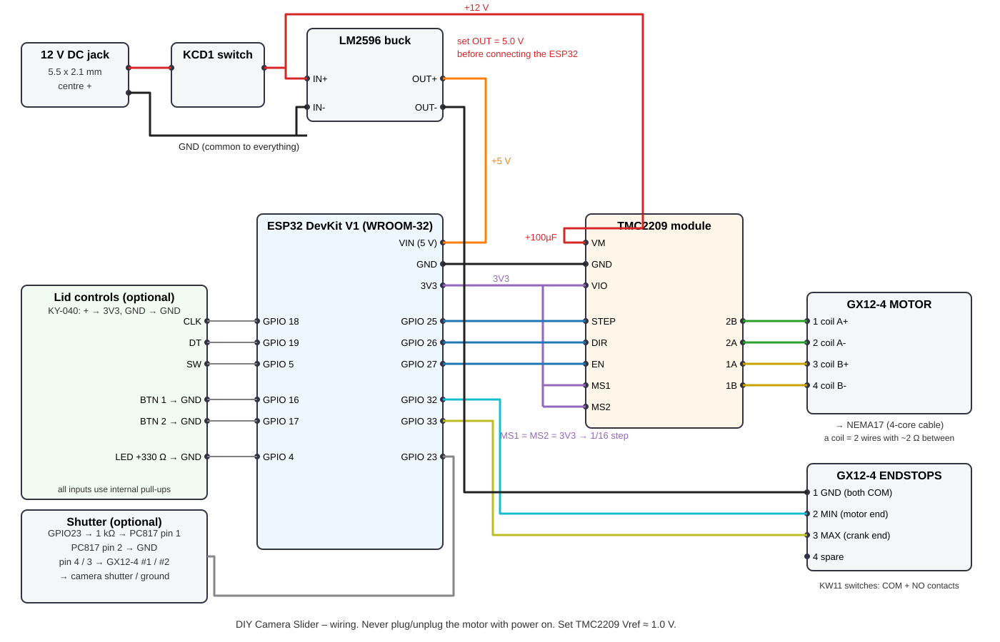
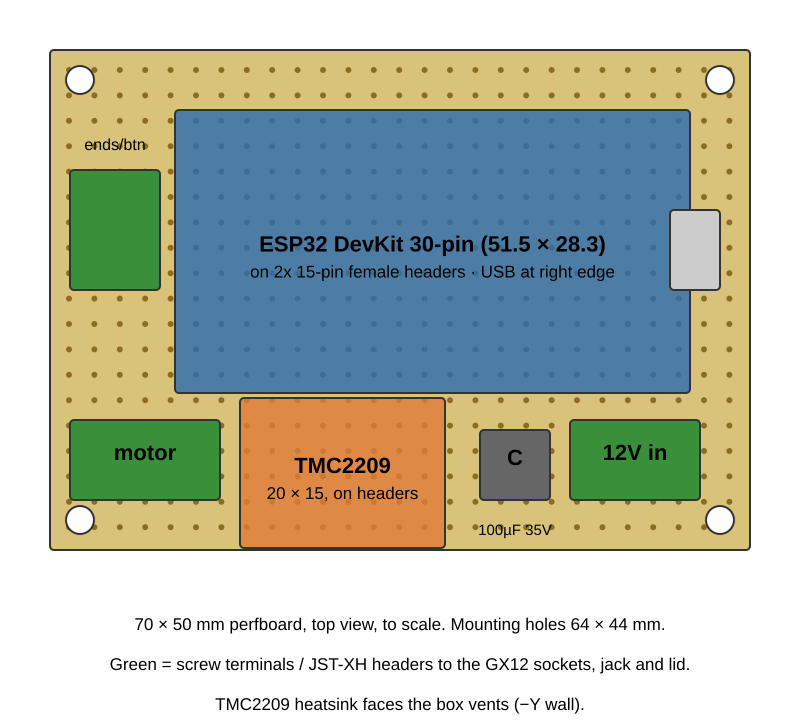

# Wiring



Everything except the motor and the switches lives in the **electronics box**. The motor, the endstops and
the camera shutter cable plug into **3 GX12-4 sockets** on the top of the box, so the box comes off the
slider without any soldering.


```
 12 V adapter / 3S battery
        │
   DC jack ── rocker switch ──┬───────────────► TMC2209  VM   (+100 µF 35 V across VM/GND)
                              │
                              └─► LM2596 IN+   (set OUT to 5.0 V BEFORE connecting the ESP32!)
                                   LM2596 OUT+ ─► ESP32 VIN (5V pin)
 all GND tied together ◄──────────── LM2596 GND, TMC2209 GND (both), ESP32 GND
```

## GX12-4 sockets (box top, left to right seen from the front)

| Socket | Pin 1 | Pin 2 | Pin 3 | Pin 4 | Cable |
|--------|-------|-------|-------|-------|-------|
| **MOTOR** (X = −30) | coil A+ (TMC 2B) | coil A− (TMC 2A) | coil B+ (TMC 1A) | coil B− (TMC 1B) | 4-core, ~0.5 m to the motor |
| **ENDSTOPS** (X = 0) | GND (both switch COM) | MIN (GPIO 32) | MAX (GPIO 33) | spare | 4-core, ~1.2 m: splits to both end blocks |
| **SHUTTER** (X = +30) | PC817 collector (pin 4) | PC817 emitter (pin 3) | – | – | to the camera remote cable |

Solder the female (panel) half in the box and the male (plug) half on the cables. Put heat-shrink on
every pin. The motor plug must never be pulled while the power is on.

## Inside the box



* **Perfboard 70 × 50 mm** on the 4 standoffs, on the +X side of the box: ESP32 on female headers (USB lines up
  with the hole in the +X wall), TMC2209 on female headers with its heatsink toward the vent wall,
  100 µF cap, JST-XH / screw terminals for the wires going to the GX12 sockets, the jack and the lid.
* **LM2596** in the printed frame on the −X side (foam tape). Set it to **5.0 V before** wiring the ESP32.
* **DC jack + KCD1 switch** in the −X wall, **KY-040 + 2 buttons + LED** in the lid.

## ESP32 DevKit V1 pin map

| ESP32 pin | Goes to | Notes |
|-----------|---------|-------|
| VIN (5V)  | LM2596 OUT+ (5.0 V) | |
| GND       | common ground | |
| 3V3       | TMC2209 **VIO / VDD**, **MS1**, **MS2** | MS1 = MS2 = high → 1/16 microstep |
| GPIO 25   | TMC2209 **STEP** | |
| GPIO 26   | TMC2209 **DIR**  | wrong direction? send `SET invert 1` then `SAVE` |
| GPIO 27   | TMC2209 **EN**   | low = motor on; high = hand mode |
| GPIO 32   | MIN endstop **NO** contact (the end that should be position 0 – normally the motor end) | switch **COM → GND** |
| GPIO 33   | MAX endstop **NO** contact (other end) | switch **COM → GND** |
| GPIO 18   | KY-040 **CLK** *(optional)* | encoder **+ → 3V3**, **GND → GND** |
| GPIO 19   | KY-040 **DT**  *(optional)* | |
| GPIO 5    | KY-040 **SW**  *(optional)* | |
| GPIO 16   | Button 1 "RUN" → GND *(optional)* | |
| GPIO 17   | Button 2 "STOP" → GND *(optional)* | |
| GPIO 4    | 330 Ω → LED → GND *(optional)* | onboard LED (GPIO 2) shows the same |
| GPIO 23   | 1 kΩ → PC817 pin 1 *(optional)* | PC817 pin 2 → GND |

TMC2209 also: **PDN/UART** – leave unconnected; **CLK** – unconnected (or GND); **DIAG / INDEX** – unconnected.

## Motor

NEMA17 4 wires: the two wires of **one coil** go to **1A / 1B** (some boards print **A1 / A2** or **2B 2A 1A 1B**),
the other coil to **2A / 2B**. To find a coil: wires that show a few ohms between them on a multimeter
(or make the shaft hard to turn when shorted together) are one coil.
If the motor only buzzes, swap the two wires of **one** coil.

⚠️ Never plug/unplug the motor while the driver has power – it kills TMC2209s.

### Motor current (Vref)

Turn the small pot on the TMC2209 with power on, measure between the pot and GND.

* Start at **Vref ≈ 1.0 V** (≈ 0.7–0.9 A RMS on most modules) – enough for this slider when level.
* Vertical / steep angle use: raise toward **1.3 V**.
* Motor too hot to touch for more than a few seconds → lower it.

Check your module's page – the exact formula differs between BigTreeTech, FYSETC and clones.

## Endstops

Micro switch (KW11): **COM → GND**, **NO → GPIO 32 (MIN, the 0 end – normally the motor end)** / **GPIO 33 (MAX, the other end)**. Leave NC empty.
No switches? Send `SET endstops 0`, `SAVE` – then use **ZERO** to set 0 wherever the carriage is.

## Camera shutter (time-lapse, optional)

```
GPIO23 ── 1 kΩ ──► PC817 pin 1 (anode)          PC817 pin 4 (collector) ──► camera "shutter" wire
GND    ──────────► PC817 pin 2 (cathode)        PC817 pin 3 (emitter)   ──► camera "ground" wire
```

The **Sony A7 IV** has no 2.5 mm remote jack; its wired remote uses the **Multi/Micro USB** terminal.
The easiest route is a cheap "Sony Multi terminal shutter release cable" (RM-VPR1 clone): cut it, find the
shutter and ground wires (they short when the button is pressed fully) and connect them to the PC817.
**Without a cable** you can still do time-lapse: use the camera's built-in **Interval Shooting** and run
the slider with a long `RUN` (e.g. `RUN 1800` = 30 min continuous slide).

## Power notes

* 12 V **2 A** adapter is plenty (the motor draws < 1 A at this setting).
* Battery: 3× 18650 in series with a **3S BMS** (≈ 11.1 V nominal, 12.6 V full). Runs for hours.
* Don't power from USB and 12 V at the same time unless your ESP32 board has a diode on VIN
  (most DevKit V1 do – check for a small diode next to the USB connector). Switch 12 V off when flashing.
